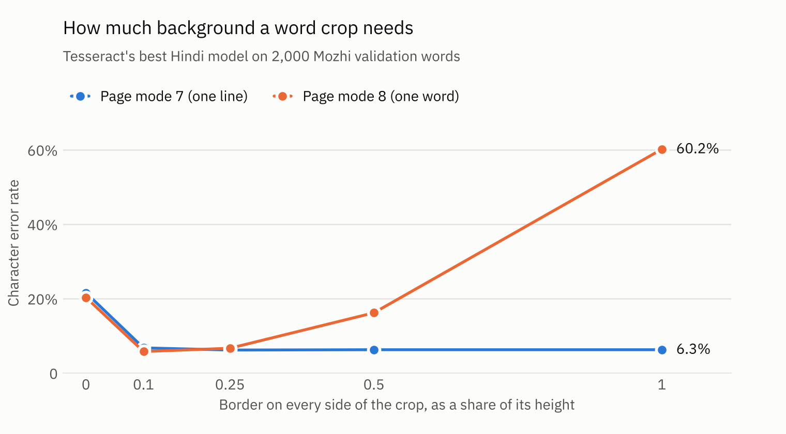

# DocLens: reading printed Hindi and English documents

DocLens reads printed Hindi and English documents: it finds the text on a page, reads it, and
pulls out the fields that matter, such as the items and the total on a receipt. Every part is
built from first principles in Python, OpenCV and PyTorch, and every part is measured against
Tesseract and modern open OCR models on the same test data.

Why Hindi and English together? Indian paperwork mixes Devanagari and Latin script on one page,
often in one line. Devanagari is also hard to read by machine: letters join under a headline
(the shirorekha), consonants fuse into conjuncts and vowel signs sit before, above or below their
consonant, so a word cannot be cut into separate characters the way an English word can.

## Roadmap

| Status | Milestone | What gets built |
|---|---|---|
| ✅ done | **M1 Baseline** | test sets (real Hindi words, real receipt words and lines, synthetic lines under eight kinds of damage); CER and WER; Tesseract measured three ways; OpenCV image cleaning compared |
| ✅ done | **M2 Recognizer** | a CRNN trained with CTC loss from scratch on synthetic lines and real words and receipts; greedy and beam decoding; rescoring with TinyGPT; tested on fonts it never saw, with intervals and paired tests against Tesseract |
| ✅ done | **M3 Pages** | finding lines on whole pages (a classical finder against docTR's detector and Tesseract), reading order, whole page accuracy, on synthetic Hindi and English pages and real receipts |
| in progress | **M4 Fields** | key information extraction on receipts: layout aware transformers (LayoutLMv3, LiLT) against a text only model, what layout adds, explanations |
| planned | **M5 Comparison** | DocLens against PaddleOCR, Surya, EasyOCR and a small vision language model: accuracy, speed, memory, licence |
| planned | **M6 Ship** | FastAPI service, Docker image, ONNX export, a demo that runs in the browser |

**M2 in one line:** a CRNN of 4.1 million parameters, trained from scratch on a laptop, reads
every test set better than Tesseract without being told the language: 0.6% CER on printed Hindi
words against 6.5%, 2.7% on receipt lines against 42.8% (results below).

**M3 in one line:** on whole pages the error left is in finding the lines, not in reading them:
the CRNN reads the true lines at 0.1% to 1.9% CER; with DocLens's classical line finder it reads
synthetic pages at 0.4% and 1.6% (Tesseract 11.4% and 9.7%), and with docTR's detector real
receipts at 5.6% (Tesseract 51.8%).

The plan, the data and every design decision (what, why, and why not the alternatives) are in
[docs/PLAN.md](docs/PLAN.md).

## Run M1 on a Mac

Once per machine: Tesseract, and FriBiDi so that Pillow can shape Devanagari
(why the second line is needed: see "If something fails" below).

```bash
brew install tesseract fribidi
echo 'export DYLD_FALLBACK_LIBRARY_PATH=/opt/homebrew/lib:/usr/local/lib:/usr/lib' >> ~/.zshrc
source ~/.zshrc
```

The environment, then the checks:

```bash
cd ~/"Tanush's Code/DocLens"
python3.13 -m venv .venv && source .venv/bin/activate
pip install -e ".[data,dev]"
python scripts/check_env.py
```

The study:

```bash
python scripts/get_data.py                 # Mozhi test and val, CORD test, Tesseract models, English text
pytest -q                                  # every test
python scripts/make_synth.py               # the synthetic test sets, from TinyGPT's held out text
python scripts/eval_tesseract.py --quick   # 200 images per set: checks the whole pipeline
python scripts/eval_tesseract.py           # the full study; interrupted runs continue where they stopped
```

Or all of it in one go: `bash scripts/run_m1.sh`.

Results: [docs/results/m1_tesseract.md](docs/results/m1_tesseract.md) (tables) and
`docs/results/m1_tesseract.json` (every number). Predictions are kept in `runs/m1/`. The chart
below comes from `python scripts/plot_m1.py` (after `pip install -e ".[plot]"`).

## What M1 measures

* **Test sets.** Mozhi Hindi: 10,173 printed words cropped from book scans at 600 DPI, each
  transcribed by hand. CORD v2: 100 photographed receipts, read as single words and as whole lines.
  Synthetic: 717 held out lines (Hindi, English and mixed), drawn once with the training fonts
  and once with six fonts kept out of all training, each line clean and under seven kinds of damage.
* **Metrics.** Character and word error rates on Unicode normalised text, the median per image,
  the share of images that fail badly (CER above 50%) and the share read perfectly.
* **Experiments.** How much background a crop needs, and which page mode copes with it;
  Tesseract's fast models against its best models; `-l hin`, `-l eng` and `-l hin+eng` on every
  set, counting outputs in the wrong script; eight OpenCV cleaning pipelines on every set; the
  characters Tesseract confuses most in Hindi. Each set is read in its own language: Hindi for
  Mozhi, English for CORD, both for the synthetic lines.

## Run M2 on a Mac

TinyGPT lives next to DocLens (`~/"Tanush's Code"/TinyGPT`): its training text feeds the synthetic
lines and its language model rescores the output.

```bash
pip install -e ".[train,track,dev]"                   # PyTorch, MLflow, test and lint tools
pip install -e ../TinyGPT safetensors                 # TinyGPT's language model, for rescoring
python scripts/get_data.py --only mozhi_train cord_train
python scripts/prepare_m2.py                          # training text, validation lines, CORD crops, alphabet
pytest -q
python scripts/bench_m2.py                            # what a training step costs on this Mac
caffeinate -i python scripts/train_crnn.py --run main # the long run; add --resume to continue one
python scripts/eval_crnn.py --run main                # the test sets, against Tesseract
caffeinate -i python scripts/train_crnn.py --run synthetic --synthetic-only
python scripts/eval_crnn.py --run synthetic           # the same model trained on synthetic lines only
python scripts/compare_runs.py main synthetic         # what the real training images add
```

Or all of it in one go: `bash scripts/run_m2.sh`. Training runs can be compared in MLflow:
`mlflow ui --backend-store-uri sqlite:///runs/mlflow.db`. Every push is checked by GitHub Actions
(lint, types, tests): `.github/workflows/ci.yml`.

## Run M3 on a Mac

```bash
pip install -e ".[pages]"                             # docTR; its detector downloads on first use
python scripts/make_pages.py                          # synthetic page sets: val, test_seen, test_unseen
python scripts/eval_pages.py --quick                  # 2 pages per set, layout and condition
python scripts/eval_pages.py                          # every page, results to docs/results/m3_pages.md
```

## Run M4 on a Mac

```bash
pip install -e ".[fields]"                          # Hugging Face transformers; the models download on first use
python scripts/prepare_m4.py                        # the OCR words of every receipt (docTR's detector, the CRNN)
python scripts/bench_m4.py                          # one vocabulary? receipt lengths, speed and memory per model
caffeinate bash scripts/run_m4.sh                   # every training run, then the evaluation (about 6 hours)
```

`scripts/run_m4.sh` trains the three models with three seeds each, the papers' box setting once as a
check, and LiLT on OCR words, then scores every run on the test receipts
(`docs/results/m4_fields.md`). A finished run is skipped when the script starts again.

## Results (M1, the Tesseract baseline)

Tesseract 5.5.3 with its best models on the M2 MacBook: page mode 7, each set in its own language,
images as they are. Every table is in [docs/results/m1_tesseract.md](docs/results/m1_tesseract.md).

| Set | What it is | Images | CER | Catastrophic | Read perfectly | Images per second |
|---|---|---:|---:|---:|---:|---:|
| Mozhi | printed Hindi words from book scans | 10,173 | 6.5% | 8.8% | 84.5% | 511 |
| Synthetic, seen fonts | Hindi, English and mixed lines, clean and damaged | 5,736 | 4.2% | 0.6% | 59.3% | 32 |
| Synthetic, unseen fonts | the same lines in six held out fonts | 5,728 | 3.2% | 0.2% | 62.4% | 33 |
| CORD words | words from photographed receipts | 2,356 | 19.9% | 18.5% | 62.9% | 538 |
| CORD lines | whole receipt lines | 791 | 42.8% | 37.4% | 28.8% | 215 |

These are the numbers M2's recognizer has to beat, on the same images with the same scorer.



* **How a crop is cut matters more than any filter.** Mozhi's crops end at the ink: without a
  border, Tesseract misreads 21.6% of the characters of the validation words. A border of paper
  colour a quarter of the crop height wide brings that to 6.2%. Page mode 8, meant for single
  words, is best with a thin border (5.8%) but falls apart with a wide one (60.2%); page mode 7
  stays near 6.3% from a quarter of the height up, so DocLens uses it for every crop.
* **Reading two languages at once costs accuracy.** With `-l hin+eng` the CER goes from 6.5% to
  9.7% on Mozhi and from 19.9% to 29.8% on CORD words, and 4% of Hindi words come out with Latin
  letters in them. Mixed lines still need both (5.1%, against 25.2% with Hindi alone). So the goal
  for DocLens is one model that reads both scripts without being told which.
* **Most outright failures on Mozhi are one punctuation mark.** 523 of the 891 badly misread words
  are a lone danda (।), often read as a pipe (|): replacing | with । after recognition would take
  Mozhi's CER from 6.5% to 5.6%. Among the other errors, the commonest are vowel signs (ै read as
  े, ू as ु) and look alike consonants (स as प, ह as द).
* **No cleaning pipeline helps on average.** On the synthetic lines the raw images score best; on
  real data the best filter gains little (Mozhi 6.5% to 6.1% with deskewing, CORD words 19.9% to
  17.5% with median denoising). Each filter fixes one kind of damage and hurts others: denoising
  halves the error on noise (5.8% to 2.8%), Sauvola thresholding fixes shadows (4.7% to 3.3%),
  deskewing fixes skew (4.5% to 2.9%), and global Otsu thresholding hurts almost everywhere (15.7%
  under shadow). M2 tests whether a recognizer trained on damaged images needs any of them.
* **Devanagari and mixed lines suffer most.** Hindi lines go from 2.6% clean to 6.9% under noise
  and 7.3% in phone photos; English lines stay between 1% and 4%; mixed lines are hardest under
  every condition (5% to 8%).
* **Receipts are the hard case.** Faded thermal print, folds and shadows: 19.9% CER on words and
  42.8% on whole lines, and 29% of the lines come back empty. The same models in a Linux container
  (Tesseract 5.3.4) left 11% of them empty, so every comparison in DocLens runs on one machine.
* **Best models against fast ones:** more accurate on real scans (Mozhi 6.5% against 7.1%, CORD
  words 19.9% against 21.6%) but slower (511 against 826 images per second on Mozhi), and no
  better on the synthetic lines (4.2% against 3.9%).
* **"Unseen" fonts are unseen by M2, not by Tesseract,** which reads them better (3.2% against
  4.2%): the six held out fonts are plain book faces, while the training fonts include decorative
  ones.

## Results (M2, the recognizer)

One CRNN of 4.1 million parameters, trained from scratch on the M2 MacBook's GPU (20,000 steps,
about 2 million samples drawn fresh, 2 h 38 min with validation; the best checkpoint came at step
18,000), reads every set with one alphabet and is never told the language. It decodes with beam
search and TinyGPT rescoring; Tesseract reads each set in its own language, as in M1. Same images,
same scorer, CER with a bootstrap 95% interval. Every table is in
[docs/results/m2_crnn.md](docs/results/m2_crnn.md).

| Set | Images | Tesseract | CRNN | CRNN against Tesseract | Read perfectly, Tesseract and CRNN |
|---|---:|---:|---:|---:|---:|
| Mozhi words | 10,173 | 6.5% (6.2 to 6.9) | 0.6% (0.5 to 0.7) | 5.9 points fewer | 84.5% and 98.1% |
| Synthetic, seen fonts | 5,736 | 4.2% (3.9 to 4.4) | 0.7% (0.6 to 0.8) | 3.5 fewer | 59.3% and 89.3% |
| Synthetic, unseen fonts | 5,728 | 3.2% (3.0 to 3.4) | 0.8% (0.8 to 0.9) | 2.4 fewer | 62.4% and 84.9% |
| CORD words | 2,356 | 19.9% (18.4 to 21.4) | 1.3% (1.1 to 1.6) | 18.5 fewer | 62.9% and 94.6% |
| CORD lines | 791 | 42.8% (39.5 to 46.1) | 2.7% (2.1 to 3.2) | 40.1 fewer | 28.8% and 79.1% |

Every difference has p < 0.001 in a paired bootstrap over the same images. The main model trains
on synthetic lines, Mozhi's training words and CORD's training receipts, none of which Tesseract
has seen. A second run with the same settings on synthetic lines only shows what the real images
add ([docs/results/m2_main_vs_synthetic.md](docs/results/m2_main_vs_synthetic.md)):

| Set | Synthetic lines only | Main model | Main against synthetic only |
|---|---:|---:|---:|
| Mozhi words | 3.9% | 0.6% | 3.2 points fewer (3.0 to 3.4) |
| CORD words | 16.8% | 1.3% | 15.4 fewer (14.3 to 16.6) |
| CORD lines | 19.9% | 2.7% | 17.3 fewer (15.8 to 18.8) |
| Synthetic, seen fonts | 0.5% | 0.7% | 0.20 more (0.16 to 0.24) |
| Synthetic, unseen fonts | 0.7% | 0.8% | 0.16 more (0.12 to 0.20) |

* **Trained on synthetic lines only, it still beats Tesseract on every set** (Mozhi 3.9% against
  6.5%, CORD words 16.8% against 19.9%, CORD lines 19.9% against 42.8%; p < 0.001 each). That is
  the fair comparison with a reader that never saw these sources. The real training images then
  cut the error on them by 84% to 92%, for 0.2 points more on the synthetic lines.
* **A lone danda, again.** The synthetic only model misreads all 576 of Mozhi's test words that
  are a lone danda (334 as I, 213 as |), 40% of its errors there: only 0.05% of the words in the
  synthetic training text stand alone as a danda, against 5.5% of Mozhi's training words. The main
  model misreads 3 of the 576.
* **Fonts it never saw:** 0.8% CER on the six held out fonts, against 0.7% on the training fonts
  and Tesseract's 3.2%.
* **Damage no longer matters, except skew.** Under blur, noise, low resolution, JPEG, shadow and
  phone photos the CRNN stays between 0.3% and 0.6% (Tesseract 2.4% to 6.5%). Lines turned by 2
  to 5 degrees are the exception: 2.7% and 3.0%, and they hold about half of all its errors on
  the synthetic lines (50% with seen fonts, 45% with unseen ones).
* **Mixed lines are still the hardest:** 1.5% and 1.6%, against 0.6% to 0.8% for Hindi lines,
  0.3% to 0.4% for English lines and Tesseract's 6.5% on mixed lines.
* **One model, almost no wrong script.** Told both languages, Tesseract writes 7.9% of the
  synthetic lines (seen fonts) partly in the wrong script; the CRNN, told nothing, 0.02%.
* **TinyGPT helps where the pixels leave doubt.** For the main model, rescoring takes the unseen
  fonts from 0.96% to 0.83% CER (WER 4.7% to 4.0%) and changes nothing measurable on Mozhi and
  CORD (p 0.88, 0.41 and 0.07 against greedy decoding). For the synthetic only model, less sure of
  real images, it cuts Mozhi from 4.6% to 3.9% and CORD words from 19.0% to 16.8%.
* **What is left in Hindi** is mostly punctuation and look alike vowel signs: curly quotes read as
  straight ones, ू and ु swapped, a colon read as a visarga (ः), ि read as े.
* **Speed.** On the Mac's GPU the CRNN reads 228 synthetic lines per second (Tesseract, on all CPU
  cores: 32) and 900 Mozhi words (Tesseract: 511). On the CPU alone it is faster on lines (58
  against 32) but slower on words (288 against 511) and receipt lines (55 against 215).
* **Training memory:** 5.3 to 5.6 GB of GPU memory for the whole run, after a first attempt ran
  out of memory: PyTorch on the Apple GPU keeps a compiled graph for every batch shape, so training
  and reading use five fixed shapes (decision 21 in the plan).

## Results (M3, whole pages)

Three line finders on 300 synthetic A4 pages (30 page designs: Hindi, English and mixed text in
one and two columns; each design clean and under four kinds of damage, once in the training fonts
and once in six held out fonts) and on CORD's 100 test receipts: Tesseract's own page analysis,
DocLens's classical finder, and docTR's pretrained detector, in docTR's reading order and in its
plain top to bottom order. M2's CRNN reads every finder's lines, and the true lines too, which
shows what reading alone costs. Page CER with a bootstrap 95% interval over page designs, since a
design's five pages share their text and layout (decision 37 in the plan). A first run on other
pages found two faults, both fixed before these pages were drawn (decision 36); its results are
in [docs/results/m3_pages_first_run.md](docs/results/m3_pages_first_run.md). Every table is in
[docs/results/m3_pages.md](docs/results/m3_pages.md).

| Reader | Synthetic, seen fonts | Synthetic, unseen fonts | CORD receipts |
|---|---:|---:|---:|
| Tesseract | 11.4% (8.6 to 14.2) | 9.7% (7.2 to 12.1) | 51.8% (44.6 to 59.5) |
| Tesseract's lines, CRNN | 10.0% (7.1 to 12.7) | 8.6% (6.0 to 11.0) | 48.1% (40.6 to 56.3) |
| Classical finder, CRNN | **0.4%** (0.2 to 0.9) | **1.6%** (0.6 to 2.8) | 44.2% (34.6 to 55.6) |
| docTR in its reading order, CRNN | 10.9% (5.1 to 17.4) | 12.0% (6.3 to 17.7) | 47.1% (42.0 to 51.7) |
| docTR top to bottom, CRNN | 44.5% (32.1 to 55.9) | 45.3% (33.0 to 56.4) | **5.6%** (3.6 to 8.0) |
| True lines, CRNN | 0.1% (0.1 to 0.2) | 0.4% (0.2 to 0.6) | 1.9% (1.3 to 2.5) |

Paired with Tesseract on the same designs, the classical finder has 11.0 and 8.1 points fewer on
the synthetic pages (p < 0.001 each), and docTR top to bottom 46.1 fewer on the receipts (p <
0.001). docTR in its reading order is not measurably better or worse than Tesseract on the
synthetic pages (p 0.85 and 0.52), and on the receipts neither the classical finder nor docTR's
reading order is measurably better than Tesseract (p 0.19 and 0.26).

Synthetic pages in the training fonts, by damage and by layout:

| Reader | clean | noise | shadow | skew | photo | one column | two columns |
|---|---:|---:|---:|---:|---:|---:|---:|
| Tesseract | 2.8% | 4.0% | 18.6% | 8.7% | 22.9% | 12.8% | 10.2% |
| Classical finder, CRNN | 0.4% | 0.4% | 0.4% | 0.4% | 0.5% | 0.2% | 0.6% |
| docTR in its reading order, CRNN | 6.6% | 7.4% | 7.3% | 20.8% | 12.5% | 0.8% | 20.1% |
| True lines, CRNN | 0.1% | 0.1% | 0.1% | 0.1% | 0.1% | 0.1% | 0.1% |

* **Reading is nearly solved; finding the lines is what is left.** The CRNN reads the true lines
  at 0.1% and 0.4% CER on the synthetic pages and 1.9% on the receipts. The best finder on each
  set leaves 0.4%, 1.6% and 5.6%.
* **The classical finder is the best on synthetic pages by far.** Line F1 99.8
  and 98.8 (Tesseract 92.8 and 93.4), a median page at 0.25% and 0.29% CER, and 0.4% to 0.5% under
  every damage in the training fonts. It reads 149 of the 150 two column pages in order. Its weak
  spot is photos of two column pages in the unseen fonts: 8.2% CER, with 36 merged lines and the
  one page it reads out of order, together 55% of its errors on that set.
* **The fixes held on fresh pages.** On these test pages the old title rule would have read 12
  and 15 of the 75 two column pages in the wrong order; the new rule reads 0 and 1. In the first
  run, with the old rule on the old pages, the classical finder read 4.8% and 5.9%.
* **docTR's reading order fails on many two column pages.** It reads 26 and 28 of the 75 two
  column pages in the wrong order, on 10 of the 15 two column designs and under every damage (4
  clean pages in each set), and those pages hold 84% of its errors: 20.1% and 21.5% on two columns
  against 0.8% and 1.2% on one. On pages turned by 1 to 4 degrees its detector also cuts 49% to
  63% of the lines into pieces; read in order, the pieces cost little on one column (1.0% and
  2.2%).
* **Reading order has to fit the document.** Top to bottom, docTR reads across both columns (47 to
  77 switches between them on a clean two column page of about 74 lines): 44.5% and 45.3%. On
  receipts it is the other way round: its reading order takes the prices for a column and reads
  every item name before every price (47.1%), while top to bottom keeps each name with its price
  (5.6%).
* **On receipts only docTR's detector finds the text well.** Read top to bottom, it gives the
  best page CER with the lowest line F1 (13.8): it finds names, quantities and prices as separate
  pieces where CORD has one row (81% of the rows come in pieces), so F1 at an IoU of 0.5 says
  little about what a reader gets. Tesseract leaves text out: 71% of its edits are characters it
  never wrote, and half the receipts come out above 50% CER. The classical finder adds text: 223
  of its 1,180 lines lie mostly outside every true line (such as separator lines that CORD does
  not mark), and 62% of its edits are characters that are not there.
* **Tesseract loses text in shadows and photos.** Under a shadow it finds 83% and 88% of the
  lines and reads 18.6% and 15.5%; the CRNN reading Tesseract's lines does little better (17.6%
  and 14.6%), so the loss is in finding. The classical finder, binarising with Sauvola's local
  threshold, reads the same pages at 0.4% and 1.0%. On photos Tesseract reads 22.9% and 19.2%.
* **Level crops end the skew problem.** Cut out along their quadrilaterals and turned level, the
  true lines of turned pages read at 0.1% and 0.4%, as on clean pages (M2's test lines, turned
  inside their crops by 2 to 5 degrees: 2.7% and 3.0%). Training on more skew, planned after M2,
  was therefore not run.
* **Speed.** Per page, finding the lines takes 0.21 s for the classical finder (on the CPU) and
  0.33 to 0.34 s for docTR (on the GPU); reading them with the CRNN 0.8 to 1.1 s on the GPU. Tesseract
  takes 11 to 12 s per page on one core.

## Layout

```
src/doclens/
  text.py         Unicode normalisation, script detection
  metrics.py      edit distance, alignment, CER and WER
  fonts.py        the bundled fonts, their scripts, splits and licences
  render.py       drawing a line of Hindi, English or both, shaped correctly
  degrade.py      blur, noise, low resolution, JPEG, skew, shadow, phone photo
  preprocess.py   grey, scaling, denoising, CLAHE, Otsu, Sauvola, deskewing
  tesseract.py    batched, parallel Tesseract
  datasets.py     Mozhi, CORD and the synthetic sets, read into one shape
  corpus.py       text lines from TinyGPT's corpus and English sentences
  alphabet.py     the characters the recognizer writes, and their class numbers
  crnn.py         the CRNN, its input preparation, CTC loss, checkpoints
  traindata.py    training batches drawn fresh: synthetic lines, Mozhi words, CORD crops
  ctc.py          greedy decoding, prefix beam search, exact CTC probability
  recognize.py    reading crops with a trained model, in five fixed batch shapes
  lm.py           TinyGPT rescoring, and choosing its weights on validation data
  stats.py        bootstrap intervals and paired comparisons
  pages.py        pages and their lines: page sets on disk, CORD receipts as pages, line crops
  pagegen.py      synthetic pages: layout, drawing, damage that moves the lines with the pixels
  layout.py       the classical line finder: binarisation, levelling, XY cut, lines from rows of ink
  doctr_lines.py  docTR's pretrained detector, its lines and reading order
  pagereader.py   reading a page's lines with the CRNN
  pagescore.py    page CER, line matching, splits and merges, reading order
  fields.py       receipts as tagged words (CORD's fields), OCR words, field F1
  kie.py          the three field extractors: windows, batches, training, tagging
scripts/          check_env, get_data, make_synth, eval_tesseract, plot_m1, run_m1.sh,
                  prepare_m2, bench_m2, train_crnn, eval_crnn, compare_runs, run_m2.sh,
                  make_pages, eval_pages, prepare_m4, bench_m4, train_kie, eval_kie, run_m4.sh
tests/            unit tests for all of the above
.github/          CI: lint, type checks and tests on every push
fonts/            35 font files with their licences (fonts/README.md)
docs/             PLAN.md and results/
data/, runs/      downloads and outputs, never committed
```

## Data and licences

| What | Source | Licence |
|---|---|---|
| Mozhi Hindi printed words | [IIIT Hyderabad, NLTM OCR](https://ilocr.iiit.ac.in/dataset/7/) | CC BY 4.0 |
| CORD v2 receipts | [Clova AI](https://github.com/clovaai/cord), via the Hugging Face Hub | CC BY 4.0 |
| Tesseract models (fast and best) | [tessdata_fast](https://github.com/tesseract-ocr/tessdata_fast), [tessdata_best](https://github.com/tesseract-ocr/tessdata_best) | Apache 2.0 |
| English sentences | `findnitai/english-to-hinglish` on the Hugging Face Hub | Apache 2.0 |
| Hindi and Hinglish text | TinyGPT's held out split (Hindi Wikipedia and Hinglish sources) | as in TinyGPT |
| Fonts | see [fonts/README.md](fonts/README.md) | OFL 1.1, Apache 2.0, GPL with font exception, and others |

`get_data.py` records the SHA256 of every downloaded file in `data/MANIFEST.json`, so each result
can name the exact data and models it came from.

## If something fails

* **`check_env.py` says Pillow cannot shape Devanagari.** Pillow's own wheels include libraqm, which
  draws Devanagari correctly, but it loads the FriBiDi library when Python starts, looking for it by
  name and in `/usr/local/lib`. Homebrew on Apple silicon keeps it in `/opt/homebrew/lib`, which is
  not searched unless `DYLD_FALLBACK_LIBRARY_PATH` says so: run the three setup lines above, open a
  new terminal, activate the environment and check again. Without shaping, DocLens refuses to draw
  Hindi rather than draw it wrong.
* **`tesseract not found`.** `brew install tesseract`.
* **A `SKIP` line in `eval_tesseract.py`.** That set's data is missing: run `get_data.py` again.

## Licence

The code is MIT licensed ([LICENSE](LICENSE)). Fonts, datasets and models keep their own licences,
listed above.
